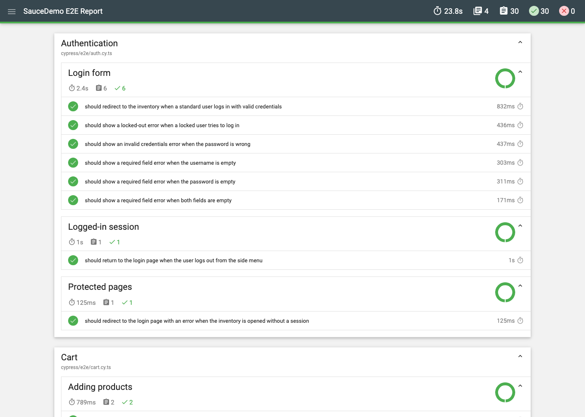

# SauceDemo E2E Test Suite

End-to-end test automation for the [SauceDemo](https://www.saucedemo.com) web store, built with Cypress and TypeScript.
It covers authentication, inventory, cart and checkout, and documents real defects found in the application.

[](https://github.com/nlarreadiaz/saucedemo-cypress-e2e/actions/workflows/e2e.yml)

---

## Tech stack

| Tool                                                                                    | Purpose                                               |
| --------------------------------------------------------------------------------------- | ----------------------------------------------------- |
| [Cypress 16](https://www.cypress.io/)                                                   | E2E test runner                                       |
| TypeScript (strict mode)                                                                | Type-safe tests, page objects and fixtures            |
| Page Object Model                                                                       | Separation of page structure from test logic          |
| [@cypress/grep](https://github.com/cypress-io/cypress/tree/develop/npm/grep)            | Tag-based test selection (`@smoke`, `@known-defect`)  |
| [cypress-mochawesome-reporter](https://github.com/LironEr/cypress-mochawesome-reporter) | HTML report with embedded screenshots                 |
| ESLint + eslint-plugin-cypress + Prettier                                               | Linting and consistent formatting                     |
| GitHub Actions                                                                          | Continuous integration on every push and pull request |

## What is tested

| Area               | Tests | Coverage                                                                                                                                                                                                              |
| ------------------ | :---: | --------------------------------------------------------------------------------------------------------------------------------------------------------------------------------------------------------------------- |
| **Authentication** |   8   | Valid login, locked-out user, wrong password, empty username/password, logout from the side menu, protected route without a session                                                                                   |
| **Inventory**      |   7   | All 6 products with name, price and image; sorting by name (A-Z, Z-A) and price (low-high, high-low) checked against the real list order; product detail and back navigation; slow login of `performance_glitch_user` |
| **Cart**           |   6   | Badge count, cart contents vs. badge, removing from inventory and from the cart, persistence across pages and a full page reload                                                                                      |
| **Checkout**       |   9   | Full purchase flow, subtotal/tax/total calculation, required field validation, cancel, data-driven purchases for several customers                                                                                    |
| **Known defects**  |  11   | 8 real bugs found with `problem_user` and `error_user` (see [Known defects found](#known-defects-found))                                                                                                              |

**30 regression tests** run on every commit, plus **11 quarantined known-defect tests**.
Tests tagged `@smoke` (login, inventory, add to cart, full purchase) form a fast critical-path suite.

## Project structure

```
.
├── .github/workflows/e2e.yml   # CI pipeline: static checks, E2E tests, known defects
├── cypress/
│   ├── e2e/                    # Test specs, one per feature
│   │   ├── auth.cy.ts
│   │   ├── inventory.cy.ts
│   │   ├── cart.cy.ts
│   │   ├── checkout.cy.ts
│   │   └── known-defects.cy.ts # Quarantined tests that document real bugs
│   ├── pages/                  # Page Objects: elements and actions, no assertions
│   │   ├── BasePage.ts         # Header, side menu and cart link shared by all pages
│   │   ├── LoginPage.ts
│   │   ├── InventoryPage.ts
│   │   ├── ProductDetailPage.ts
│   │   ├── CartPage.ts
│   │   ├── CheckoutInfoPage.ts
│   │   ├── CheckoutOverviewPage.ts
│   │   └── CheckoutCompletePage.ts
│   ├── fixtures/               # Test data: no hardcoded values in specs
│   │   ├── users.json
│   │   ├── products.json
│   │   ├── checkout-data.json
│   │   ├── messages.json
│   │   └── known-defects.json
│   └── support/
│       ├── commands.ts         # cy.login() and cy.seedCart() custom commands
│       ├── index.d.ts          # Type declarations for the custom commands
│       ├── e2e.ts              # Global setup: grep, reporter, network stubs
│       ├── types.ts            # Types derived from the fixtures
│       ├── products.ts         # Catalog lookup helper
│       ├── utils.ts            # Price parsing and money rounding
│       └── constants.ts        # Named timeouts for known slow scenarios
├── scripts/report.mjs          # Runs the suite and opens the HTML report
├── cypress.config.ts
├── eslint.config.mjs
└── tsconfig.json
```

## Getting started

**Requirements:** Node.js 24 LTS (see `.nvmrc`) and npm.

```bash
git clone https://github.com/nlarreadiaz/saucedemo-cypress-e2e.git
cd saucedemo-cypress-e2e
npm ci
```

### Running the tests

| Command                                   | Description                                           |
| ----------------------------------------- | ----------------------------------------------------- |
| `npm run cy:open`                         | Open the Cypress interactive runner                   |
| `npm test`                                | Run the regression suite headless (Electron)          |
| `npm run test:chrome`                     | Run the regression suite in Chrome                    |
| `npm run test:firefox`                    | Run the regression suite in Firefox                   |
| `npm run test:smoke`                      | Run only the critical `@smoke` tests                  |
| `npm run test:defects`                    | Run only the `@known-defect` tests (expected to fail) |
| `npm run report`                          | Run the suite and open the HTML report                |
| `npm run lint` / `npm run lint:fix`       | Lint the code                                         |
| `npm run format` / `npm run format:check` | Format the code with Prettier                         |
| `npm run typecheck`                       | Type-check the project with `tsc`                     |

A single bug can be run by its tag, e.g. `npx cypress run --expose grepTags=@BUG-003`.

## Test report

Every run generates an HTML report at `cypress/reports/index.html`, with screenshots of failed tests embedded. In CI, the report, screenshots and videos are uploaded as workflow artifacts.

<!-- Report screenshot: see "How to update the report screenshot" below -->



## Known defects found

The suite uses SauceDemo's intentionally faulty users to show how defects are detected and reported.
Each defect has a test that asserts the **expected** behaviour, so it fails while the bug exists and will pass once it is fixed.

| ID      | Defect                                                             | Affected users               | Evidence (failing assertion)                                                                                                            |
| ------- | ------------------------------------------------------------------ | ---------------------------- | --------------------------------------------------------------------------------------------------------------------------------------- |
| BUG-001 | All product images show the same placeholder picture               | `problem_user`               | Every image `src` is `sl-404.jpg` instead of the product image                                                                          |
| BUG-002 | Sorting the inventory does not reorder the products                | `problem_user`, `error_user` | List order is unchanged after selecting "Name (Z to A)"                                                                                 |
| BUG-003 | Some products cannot be added to the cart from the inventory       | `problem_user`, `error_user` | "Add to cart" does nothing for Bolt T-Shirt, Fleece Jacket and Test.allTheThings() T-Shirt; `error_user` also throws a JavaScript error |
| BUG-004 | Products cannot be removed from the cart on the inventory page     | `problem_user`, `error_user` | "Remove" does not change the button or the badge                                                                                        |
| BUG-005 | Opening a product shows the details of a different product         | `problem_user`               | Clicking "Sauce Labs Backpack" opens "Sauce Labs Fleece Jacket"                                                                         |
| BUG-006 | Typing in the Last Name field writes into the First Name field     | `problem_user`               | Last Name stays empty and First Name is overwritten; checkout is blocked                                                                |
| BUG-007 | Last Name field ignores input and the form is submitted without it | `error_user`                 | Last Name stays empty, but the required-field validation is bypassed                                                                    |
| BUG-008 | Clicking Finish does not complete the order                        | `error_user`                 | The user stays on the overview page and a JavaScript error is thrown                                                                    |

**How they are managed (quarantine):**

- Tagged `@known-defect` plus their own `@BUG-xxx` id, and listed in [`fixtures/known-defects.json`](cypress/fixtures/known-defects.json).
- Excluded from the default run, so the main pipeline stays green and any **new** failure means a real regression.
- Run in a separate, non-blocking CI job, so they stay visible in every pipeline run.
- Validated in both directions: they fail with the faulty users and pass when run with `standard_user`.

## Technical decisions

**Page Object Model.** Selectors and user actions live in one place per page. When the UI changes, only the page object is updated, not every test. Page objects expose elements and actions only; all assertions live in the specs, so each test reads as a clear specification.

**`cy.session()` for login.** Logging in through the UI before every test is slow and repeats what `auth.cy.ts` already covers. `cy.login(user)` logs in once per user, caches the session and validates it through the `session-username` cookie. Only the authentication tests use the login form.

**Seeding state instead of clicking through it.** When the cart is only a precondition (checkout tests), `cy.seedCart()` writes it to `localStorage` the same way the app does. The UI path is still covered by `cart.cy.ts` and by one full end-to-end purchase test. This keeps tests fast and stops an unrelated failure from breaking many tests at once.

**`data-test` selectors.** These attributes exist only for testing, so they do not change when styles or copy change. CSS classes and XPath are never used. One documented exception: the menu button's `data-test` is on an image covered by the real `<button>`, so the button's stable `id` is used instead of forcing a click a real user could not make.

**No fixed waits.** `cy.wait(<ms>)` makes tests either slow or flaky. Every check relies on Cypress's retry-ability (assertions retry until they pass or time out). The only longer timeout is a named constant for the intentionally slow `performance_glitch_user`. ESLint fails the build if a fixed wait or `{ force: true }` is introduced.

**Independent, data-driven tests.** No test depends on another or on execution order: every test sets up its own state. Test data lives in fixtures, and expected values (sorting order, totals) are calculated from the fixtures, an oracle independent from the page under test. Totals are rounded to cents to avoid floating-point errors.

**Isolation from third parties.** SauceDemo sends telemetry to an external service. It is stubbed with `cy.intercept()`, so tests do not depend on network noise outside the application.

**Retries.** `runMode` retries (2) absorb transient network issues in CI. All tests were checked to pass on the first attempt. Known-defect tests use `retries: 0` because they are deterministic.

## Next improvements

- **API testing:** cover a REST API with `cy.request()` (SauceDemo is front-end only, so it would need a companion API).
- **Visual testing:** detect visual regressions such as those shown by `visual_user` with a tool like Percy or `cypress-image-diff`.
- **Accessibility:** add automated WCAG checks on every page with `cypress-axe`.
- **Cross-browser matrix:** run Chrome, Firefox and Edge in parallel in CI.
- **Dependency updates:** keep Cypress and actions up to date with Dependabot or Renovate.

## How to update the report screenshot

1. Run `npm run report`. The report opens in your browser when the run finishes.
2. Expand one or two tests so the steps are visible, then take a screenshot of the window.
3. Save it as `docs/images/report.png` and commit it.

## Author

**Néstor Larrea Díaz**: QA Automation

- GitHub: [github.com/nlarreadiaz](https://github.com/nlarreadiaz)
- LinkedIn: [linkedin.com/in/nlarreadiaz](https://www.linkedin.com/in/nlarreadiaz/)

## License

[MIT](LICENSE)
